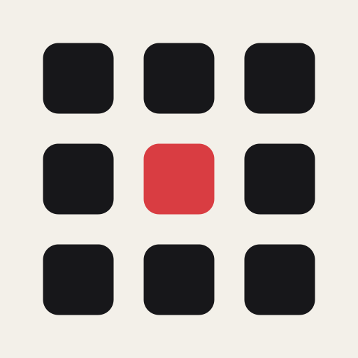
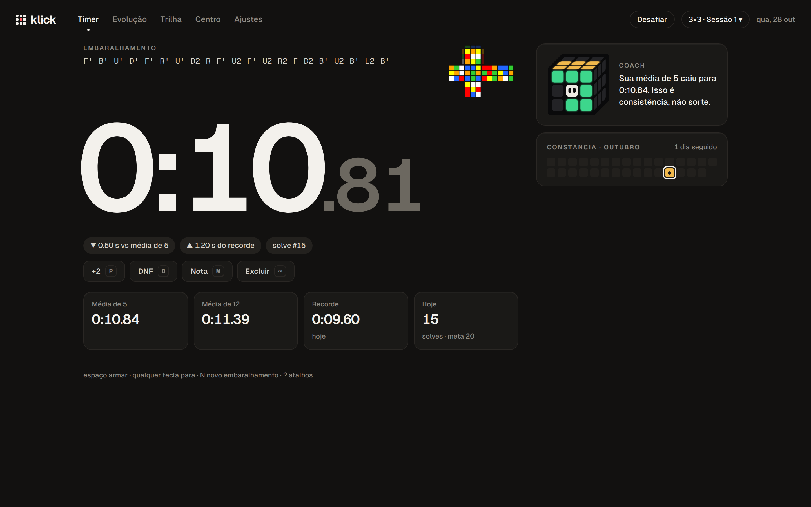
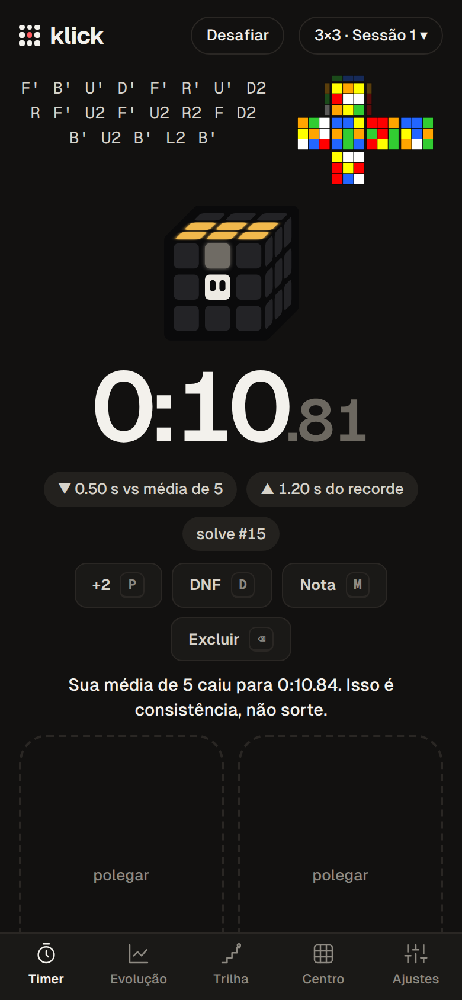
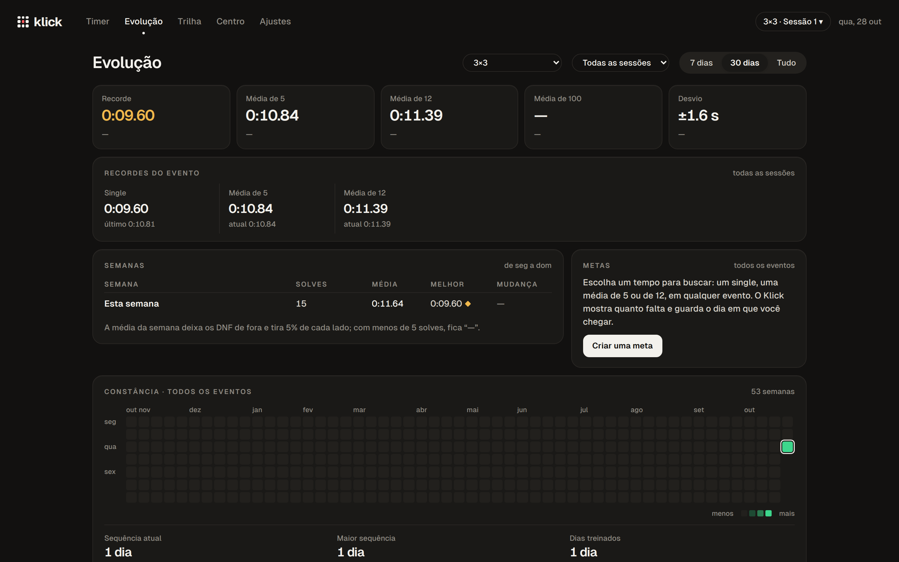

# Klick

A speedcubing timer for all 13 WCA events, with official scrambles, detailed stats and an offline-first PWA. Your solves stay on your device; an optional account syncs them across devices.

[](LICENSE)

**Live:** https://klick.ranimontagna.com

> The interface is in Brazilian Portuguese for now. An English version is planned but not available yet.

<p align="center">
  
  
</p>

<p align="center">
  
</p>

## Features

**Timer**
- WCA scrambles from [cubing.js](https://github.com/cubing/cubing.js) for all 13 events (3x3 to 7x7, OH, BLD, Megaminx, Pyraminx, Skewb, Square-1, Clock), with an optional scramble image.
- WCA inspection: 15 s with warnings at 8 s and 12 s (beep or spoken), automatic +2 and DNF.
- Hold-to-arm with an adjustable hold time; on phones, arm with two thumbs or a single touch.
- Phase splits: mark the end of each phase during the solve to time 2 to 4 phases (for example cross, F2L, OLL, PLL).
- Typed entry mode for people who time on a physical timer.
- Keyboard shortcuts for +2, DNF, notes, delete, undo and new scramble.
- A coach line after each solve: new records, milestones, a daily solve goal, signs of fatigue.

**Stats and progress**
- Multiple sessions per event; move solves and merge sessions.
- Averages (ao5, ao12, mo3 where the event uses it), records, standard deviation and the change against the previous period.
- Solve chart, time distribution, a 12-week table and a year-long training calendar with streaks.
- Average time per phase, when phase splits are on.
- Personal goals (single, ao5 or ao12 below a target) with progress and the date you reached them.
- Full history with notes, penalties and filters by event, session and period.
- Centro, a companion cube that reacts to your solves, with nine milestones per season and finishes to unlock.

**Learning trail**
- Nine steps from the layer-by-layer beginner method to intuitive F2L, 2-look OLL and PLL, and F2L algorithms, with lessons on an animated 3D cube.
- An algorithm trainer for 2-look OLL, 2-look PLL and F2L cases, tracking which cases are weak or solid. Trainer times stay out of your stats.

**Challenge links**
- Solve seven scrambles and send a link. The other person plays against your times, one scramble at a time; first to 3 points wins, and the reply link shows the whole match. No account needed.

**Your data**
- Everything is stored on the device (IndexedDB) and works offline after the first visit.
- Automatic local backups (every 50 solves and once a day), an optional backup folder on disk and a 30-day trash.
- Import and export in Klick's own format and the csTimer format.

**Account and sync (optional)**
- Passwordless sign-in with a 6-digit email code or a passkey.
- Sync across devices, daily cloud copies kept for 30 days that you can restore, and account deletion from the app.

**App**
- Installable PWA with an update prompt, light, dark and system themes, a reduced-motion option and screen-reader text.

## Tech stack

- **Front end:** Svelte 5, TypeScript, Vite, vite-plugin-pwa (Workbox), IndexedDB via `idb`, cubing.js for scrambles and the 3D cube.
- **Server:** a Cloudflare Worker that serves the app and the `/api` routes: Better Auth (email code and passkeys), a Durable Object per account, D1 for sign-in data, R2 for cloud copies, Turnstile and Resend for the email code.
- **Tests:** Vitest with Testing Library, `@cloudflare/vitest-plugin` for the Worker, Playwright with axe for end-to-end and accessibility checks.

## Getting started

Prerequisites: Node.js 22 or newer and [pnpm](https://pnpm.io).

```bash
git clone -b v2 https://github.com/raniellimontagna/klick.git
cd klick/app
pnpm install
pnpm dev
```

`pnpm dev` bundles cubing.js into `public/vendor/cubing/` and starts Vite. It serves the app only: without the Worker answering `/api/health`, the account section stays hidden and everything else works locally.

## Scripts

Run inside `app/`.

| Script | What it does |
| --- | --- |
| `pnpm dev` | Bundle cubing.js and start the Vite dev server |
| `pnpm build` | Bundle cubing.js and build the app into `dist/` |
| `pnpm preview` | Serve the production build locally |
| `pnpm test` | Unit tests (Vitest) |
| `pnpm test:worker` | Worker, Durable Object, D1 and R2 tests inside workerd |
| `pnpm test:e2e` | End-to-end tests (Playwright; run `pnpm exec playwright install chromium` once) |
| `pnpm test:e2e:sync` | End-to-end account and sync tests against a local `wrangler dev` |
| `pnpm check` | `svelte-check` and `tsc` for the app, the Worker and the tests |
| `pnpm deploy:beta` / `pnpm deploy:production` | Build and deploy with Wrangler |

Deploying has an ordered checklist (database migrations, secrets, limits). Read [`app/README.md`](app/README.md) before running either deploy script.

## Project structure

```text
app/
  src/
    core/       pure logic: timer, stats, events, goals, seasons, trail, challenges, sync rules
    data/       IndexedDB, backups, import and export
    scramble/   cubing.js loader and scramble queue
    sync/       account and sync client
    ui/         Svelte screens: timer, stats, trail, companion, settings, dialogs
  worker/       Cloudflare Worker for /api (accounts, sync, cloud copies) and D1 migrations
  tests/        unit, worker, e2e, e2e-sync and perf suites
  scripts/      build helpers (cubing.js bundle, dist check, icons)
  public/       icons, headers and the privacy policy page
prototype/      the original no-build prototype (plain HTML, CSS and JS)
docs/           specs, plans, research and design mockups (in Portuguese)
```

The previous version (React + Supabase) is archived on the [`main`](https://github.com/raniellimontagna/klick/tree/main) branch, tag `v1.4.0`.

## License

Released under the [MIT License](LICENSE).
